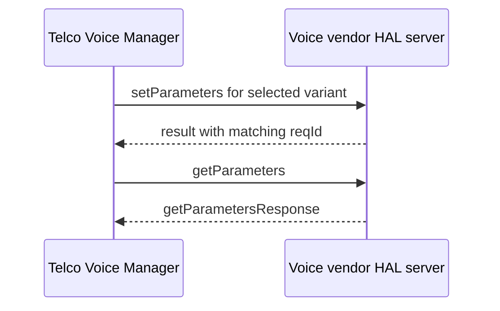

# Telco Voice JSON HAL Specification

## Version History

| Date | Comment | Version |
| --- | --- | --- |
| — | Documentation alignment; schemas unchanged. | — |

## Acronyms

HAL means Hardware Abstraction Layer; SIP means Session Initiation Protocol; RTP means Real-time Transport Protocol; POTS means Plain Old Telephone Service.

## Description

Telco Voice Manager consumes the JSON HAL contract to configure and observe vendor voice functionality.

| Schema contract | Consuming component | Data model |
| --- | --- | --- |
| `telcovoice_hal_schema_v1.json` | Telco Voice Manager | VoiceProfile/Line-oriented v1. |
| `telcovoice_hal_schema_v2.json` | Telco Voice Manager | SIP/CallControl/POTS-oriented v2. |

These are alternative product contracts; do not mix their paths. Both use module `voicehal`, version `0.0.1`. Product build and deployment select the variant. See the [detailed protocol reference](halSpecDetailed.md).

## Component Runtime Execution Requirements

### Initialization and Process Model

Deploy the selected schema and start the vendor server before Telco Voice Manager requests. Configuration selects `/etc/rdk/schemas/telcovoice_hal_schema.json` and port `20104`; verify the variant installed at that unversioned path. Communication uses the shared JSON HAL library over IPv4 TCP.

### Threading and Memory Model

Serialize shared client control and teardown. Manage C-side JSON objects according to json-c ownership rules; copy callback data needed after notification processing.

### Asynchronous Notification Model

Both variants expose the firewall-rule-data event. Use the selected schema's event list to determine subscription eligibility.

### Blocking Calls

Synchronous library requests wait for a reply or timeout. A timeout does not cancel remote hardware work.

### Error Reporting

Check transport/library status separately from wire `Result.Status`. A successful set does not establish completed SIP registration or a working call.

## Nonfunctional Requirements

### Logging and Debugging

Implementations must not log credentials, secrets, security-sensitive information, or other sensitive data. Log operation outcomes rather than payloads.

### Build and Quality Requirements

Use the product build integration and compatible JSON HAL library. Preflight the selected schema and resolve invalid references before testing. Restore changed voice configuration using an approved product procedure.

## Interface API Documentation

The [detailed reference](halSpecDetailed.md) describes all eleven actions, variant-specific parameter indexes, initialization, and event contracts. Determine read/write eligibility from the selected variant's action lists.

## Sequence Diagram

## Source References

- [Voice v1 schema](https://github.com/rdkcentral/telco-voice-manager/blob/main/hal_schema/telcovoice_hal_schema_v1.json)
- [Voice v2 schema](https://github.com/rdkcentral/telco-voice-manager/blob/main/hal_schema/telcovoice_hal_schema_v2.json)
- [Manager configuration](https://github.com/rdkcentral/telco-voice-manager/blob/main/config/telcovoice_manager_conf.json)
- [Component build identity](https://github.com/rdkcentral/telco-voice-manager/blob/main/configure.ac)
